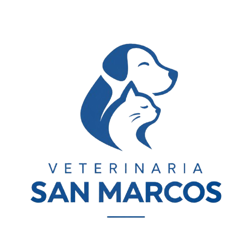

<p align="center">
  
</p>

# Veterinaria San Marcos

Aplicación web para la gestión de servicios veterinarios, mascotas y solicitudes de citas. Desarrollada con React, Vite y Bootstrap, ofrece una experiencia responsive y espacios de trabajo organizados según el rol de cada usuario.

Repositorio: [Vet-San-Marcos-React](https://github.com/DC-mati/Vet-San-Marcos-React)  
Rama principal de entrega: [`main`](https://github.com/DC-mati/Vet-San-Marcos-React/tree/main)  
Rama de desarrollo integrada: [`RamaHana`](https://github.com/DC-mati/Vet-San-Marcos-React/tree/RamaHana)

---

## Funcionalidades

### Sitio público

- Página de inicio
- Catálogo de servicios con búsqueda y filtros por categoría
- Página de categorías
- Detalle de cada servicio
- Blog informativo
- Nosotros y contacto
- Inicio de sesión y registro de dueños

### Dueño de mascota

- Dashboard personal con resumen de mascotas y citas
- Gestión de mascotas registradas
- Catálogo privado dentro del panel (`/dueno/catalogo`)
- Solicitud de citas con validación y resumen
- Confirmación de solicitudes
- Consulta de citas propias y seguimiento de estados

### Recepción

- Panel de gestión de solicitudes
- Confirmación de citas y cambio de estados
- Propuesta de reprogramación de horario
- Consulta de pacientes (mascotas registradas)
- Filtros por fecha y estado en la agenda

### Veterinario

- Dashboard con indicadores de citas
- Consulta de agenda clínica y próximas atenciones

### Técnico veterinario

- Dashboard de apoyo operativo
- Consulta de agenda próxima e información operativa de citas

### Administrador

- Dashboard con métricas del sistema
- CRUD de servicios del catálogo
- Gestión de usuarios (cuentas demo y registradas)
- Gestión de citas
- Inventario de medicamentos con alertas de stock bajo
- Acceso a recepción desde el panel admin (`/admin/recepcion`)
- Reportes resumidos por estado, categorías de servicios e inventario

---

## Tecnologías utilizadas

| Tecnología | Uso en el proyecto |
|------------|-------------------|
| React | Interfaz de usuario con componentes funcionales |
| Vite | Entorno de desarrollo y build de producción |
| JavaScript (JSX) | Lenguaje principal del frontend |
| Bootstrap | Estilos base y sistema responsive |
| React Bootstrap | Componentes UI (formularios, tablas, navegación) |
| React Router | Rutas públicas, privadas y redirecciones por rol |
| Context API | Estado compartido (auth, citas, servicios, mascotas, inventario) |
| localStorage | Persistencia simulada de datos en el navegador |
| Vitest | Ejecución de pruebas unitarias e integración ligera |
| Testing Library | Renderizado y aserciones orientadas al usuario |
| Git y GitHub | Control de versiones y trabajo colaborativo en ramas |

---

## Arquitectura

El frontend sigue **Atomic Design** para organizar la interfaz:

| Capa | Contenido |
|------|-----------|
| **Atoms** | Elementos mínimos reutilizables (etiquetas, entradas) |
| **Molecules** | Combinaciones simples (tarjetas, filas, buscadores) |
| **Organisms** | Secciones completas (header, formularios, listados) |
| **Templates** | Layouts de panel (`PlantillaAdmin`, `PlantillaPublica`) |
| **Pages** | Pantallas enlazadas a rutas en `App.jsx` |

Otros directorios relevantes:

| Carpeta | Rol |
|---------|-----|
| `src/data/` | Datos iniciales del catálogo (servicios, citas demo) |
| `src/services/` | Lógica CRUD y reglas de negocio sin JSX |
| `src/context/` | Proveedores de estado global |
| `src/utils/` | Validaciones, fechas, precios y helpers |
| `src/constants/` | Rutas y enlaces de navegación por rol |
| `src/test/` | Configuración compartida de Vitest (`setup.js`) |

```text
src/
├── components/
│   ├── atoms/
│   ├── molecules/
│   ├── organisms/
│   └── templates/
├── pages/
├── services/
├── context/
├── utils/
├── data/
├── constants/
├── assets/
└── test/
public/          # Favicon e íconos estáticos
```

---

## Instalación

Requisitos: **Node.js 20.19+** o **22.12+** (compatible con Vite 8, según la [documentación oficial de Vite](https://vite.dev/guide/#)) y **npm**.

```bash
git clone -b main https://github.com/DC-mati/Vet-San-Marcos-React.git
cd Vet-San-Marcos-React
npm install
```

---

## Ejecución

Modo desarrollo:

```bash
npm run dev
```

Abre en el navegador la URL que muestra Vite en consola (habitualmente `http://localhost:5173`).

Build de producción y vista previa:

```bash
npm run build
npm run preview
```

Lint:

```bash
npm run lint
```

---

## Pruebas unitarias

La suite activa utiliza **Vitest**, **Testing Library** y el patrón **Arrange, Act, Assert** en español. Cada archivo `.test.js` o `.test.jsx` está junto al módulo que verifica.

Objetivo actual: **10 pruebas** que cubren servicios críticos, utilidades y un flujo integrado de rutas.

```bash
npm run test:run
npm run test:cov
```

El informe HTML de cobertura se genera en `coverage/` (excluido de Git). No se publica en el repositorio.

---

## Integrantes del Grupo 9

| Integrante | Correo institucional |
|------------|-------------------|
| Hanael Echeverría | ha.echeverria@duocuc.cl |
| Matías Soto | mat.sotoz@duocuc.cl |

---

## Bitácora de desarrollo

Registro basado en el historial de Git del repositorio. Los enlaces apuntan a commits reales en GitHub.

| Fecha | Responsable | Actividad realizada | Evidencia |
|-------|-------------|---------------------|-----------|
| 2026-09-22 | Matías Soto | Creación del repositorio e inicio del proyecto | [Ver commit](https://github.com/DC-mati/Vet-San-Marcos-React/commit/1459572) |
| 2026-09-22 | Hanael Echeverría | Actualización del README y documentación inicial | [Ver commit](https://github.com/DC-mati/Vet-San-Marcos-React/commit/dc6d7d6) |
| 2026-09-29 a 2026-10-12 | Matías Soto | Incorporación de assets y avance del sitio público | [Ver commit](https://github.com/DC-mati/Vet-San-Marcos-React/commit/8066b49) |
| 2026-10-13 | Matías Soto | Rama de trabajo y ajustes de título de la aplicación | [Ver commit](https://github.com/DC-mati/Vet-San-Marcos-React/commit/a5bce01) |
| 2026-10-23 | Matías Soto | Vista home de la veterinaria y pruebas asociadas | [Ver commit](https://github.com/DC-mati/Vet-San-Marcos-React/commit/9d9d491) |
| 2026-10-23 | Hanael Echeverría | Catálogo, solicitud de citas, CRUD y ampliación de pruebas | [Ver commit](https://github.com/DC-mati/Vet-San-Marcos-React/commit/7095ee2) |
| 2026-10-23 | Hanael Echeverría | Layout responsive y corrección de ancho global | [Ver commit](https://github.com/DC-mati/Vet-San-Marcos-React/commit/f4c1106) |
| 2026-10-23 | Hanael Echeverría | README público y exclusión de documentación privada | [Ver commit](https://github.com/DC-mati/Vet-San-Marcos-React/commit/6b70ae9) |
| 2026-10-23 | Hanael Echeverría | Navegación pública e enlaces internos | [Ver commit](https://github.com/DC-mati/Vet-San-Marcos-React/commit/a3ff840) |
| 2026-10-23 | Hanael Echeverría | Diseño y alineación de categorías | [Ver commit](https://github.com/DC-mati/Vet-San-Marcos-React/commit/73ef16b) |
| 2026-10-23 | Hanael Echeverría | Dashboard del dueño y mis citas privadas | [Ver commit](https://github.com/DC-mati/Vet-San-Marcos-React/commit/1229212) |
| 2026-10-23 | Hanael Echeverría | Unificación de dashboards y flujo privado del dueño | [Ver commit](https://github.com/DC-mati/Vet-San-Marcos-React/commit/4f7aee1) |
| 2026-10-23 | Hanael Echeverría | Mascotas, inventario y paneles ampliados | [Ver commit](https://github.com/DC-mati/Vet-San-Marcos-React/commit/cc4bf4a) |
| 2026-10-23 | Hanael Echeverría | Refuerzo de auth, citas y mascotas para QA | [Ver commit](https://github.com/DC-mati/Vet-San-Marcos-React/commit/1b0623f) |
| 2026-10-24 | Hanael Echeverría | Navegación admin en recepción y textos del sitio | [Ver commit](https://github.com/DC-mati/Vet-San-Marcos-React/commit/a4f05df) |
| 2026-10-24 | Hanael Echeverría | Catálogo del dueño dentro del panel privado | [Ver commit](https://github.com/DC-mati/Vet-San-Marcos-React/commit/72853f5) |
| 2026-10-24 | Hanael Echeverría | Estabilización de pruebas y localStorage en Vitest | [Ver commit](https://github.com/DC-mati/Vet-San-Marcos-React/commit/5d96f92) |
| 2026-10-24 | Hanael Echeverría | Suite reducida a 10 pruebas con formato AAA | [Ver commit](https://github.com/DC-mati/Vet-San-Marcos-React/commit/fdfdc22) |
| 2026-10-24 | Hanael Echeverría | README profesional, identificación Grupo 9 y favicon inicial | [Ver commit](https://github.com/DC-mati/Vet-San-Marcos-React/commit/9c1f06c) |
| 2026-10-24 | Hanael Echeverría | Ajuste del favicon con el logo completo del sitio | [Ver commit](https://github.com/DC-mati/Vet-San-Marcos-React/commit/2cec397) |
| 2026-10-24 | Hanael Echeverría | Ajustes finales: favicon con símbolo, recepción, validación de citas y requisito Node | [Ver commit](https://github.com/DC-mati/Vet-San-Marcos-React/commit/376c75d) |
| 2026-10-24 | Hanael Echeverría | Flujo público de solicitud de cita en dos etapas con registro integrado | [Ver commit](https://github.com/DC-mati/Vet-San-Marcos-React/commit/934a3f1) |
| 2026-10-24 | Hanael Echeverría | Estabilización del flujo público tras registro y limpieza de redirecciones | [Ver commit](https://github.com/DC-mati/Vet-San-Marcos-React/commit/9a1297c) |
| 2026-10-24 | Hanael Echeverría | Confirmación de citas desde el panel del dueño y sincronización de estado | [Ver commit](https://github.com/DC-mati/Vet-San-Marcos-React/commit/371da3b) |
| 2026-10-25 | Hanael Echeverría | Integración de RamaHana en main para entrega final del Grupo 9 | Ver merge en `main` |

---

## Cuentas de demostración

Contraseña común: `demo123`

| Correo | Rol |
|--------|-----|
| admin@sanmarcos.cl | Administrador |
| recepcion@sanmarcos.cl | Recepción |
| veterinario@sanmarcos.cl | Veterinario |
| tecnico@sanmarcos.cl | Técnico |
| camila@correo.cl | Dueño (cliente) |

---

## Limitaciones técnicas

- No hay backend ni base de datos remota. Los datos persisten en `localStorage` del navegador.
- La autenticación es simulada con cuentas demo para evaluar roles en la interfaz.
- No hay pagos en línea ni notificaciones por correo o SMS.
